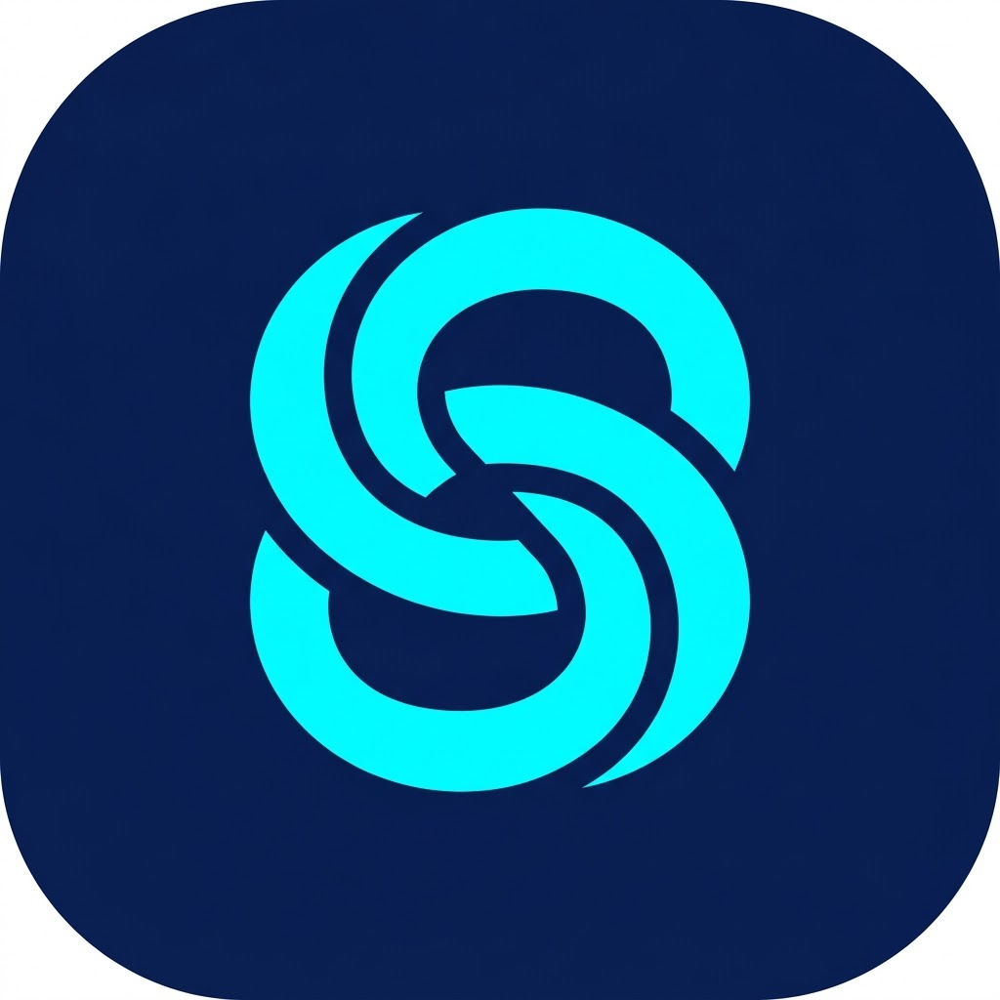
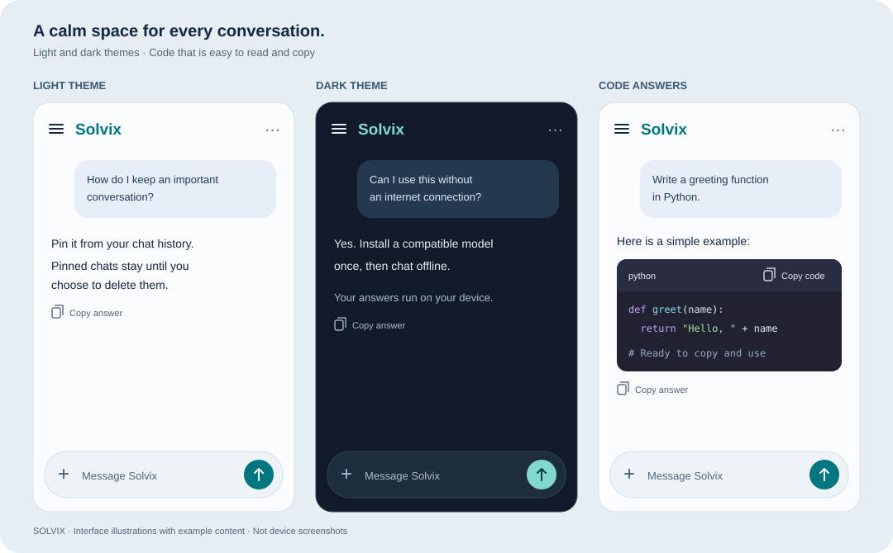

<div align="center">



# Solvix

### Your assistant. Your device. Your space.

**A clean Android chat app for private, on-device conversations.**

<p>
  
  
  
  
  <a href="LICENSE"></a>
</p>

Ask questions, share photos, and get answers that stream as they are generated.
Once a compatible model is installed, chat runs offline. No account required.

<p>
  <a href="https://github.com/Shahriar811/Solvix/releases/download/v1.3/Solvix-1.3-debug.apk"></a>
</p>

[Releases](https://github.com/Shahriar811/Solvix/releases) · [Model setup](MODEL_SETUP.md) · [Report an issue](https://github.com/Shahriar811/Solvix/issues)

Developed by **[Md. Shahriar Hossain](https://github.com/Shahriar811)**

</div>

---

## A little color. Plenty of room to think.

Navy and teal accents, softly tinted messages, and a chat-first layout keep Solvix easy to use. Choose light, dark, or system appearance.



<sub>Illustrations of the app's layout and palette, with example content. These are not device screenshots.</sub>

## Features

- **Minimal chat interface** with a restrained navy and teal palette, softly tinted chat bubbles, and light, dark and system appearance.
- **Offline text and photo questions** after the assistant is installed.
- **Streaming answers**, a stop button, text selection and copy controls.
- **Colored code blocks** with language labels, scrolling for long lines and a separate copy button for each snippet. Every answer also has a copy button with confirmation.
- **Local chat history** that keeps your 10 most recent unpinned conversations.
- **Pinned conversations** that stay until you explicitly delete them.
- **Six-model library** with model import, Hugging Face download and switching.
- **Hardware preflight** for CPU architecture, Android, RAM and storage before installation.
- **Developer information** and a GitHub profile link in Settings → About Solvix.

## Download & installation

1. Download [**Solvix 1.3 APK**](https://github.com/Shahriar811/Solvix/releases/download/v1.3/Solvix-1.3-debug.apk), or visit [Releases](https://github.com/Shahriar811/Solvix/releases).
2. Open `Solvix-1.3-debug.apk` on your Android device. If prompted, allow installation from the browser or file manager you used.
3. Open Solvix and go to **Settings → Models**. Expand a model and choose **Download** or **Import**.
4. Review the hardware and storage estimate. Downloads use **Wi-Fi only** by default. After installation, choose **Use model** and start chatting. Use **+** to choose or capture a photo with an image-capable model on supported hardware.

**Requirements:** Android 8.1+ and a 64-bit ARM device. RAM and storage requirements vary by model; a compatible Android version alone is not sufficient. The default profile requires at least 6 GiB of total RAM.

The APK is a **debug build for testing**. Model weights are downloaded or imported separately and are not bundled in the APK. Internet access is needed for downloads and external links; installed-model inference runs on your device. Camera access is optional and used when you choose to take a photo.

Read [**MODEL_SETUP.md**](MODEL_SETUP.md) for exact filenames, download sources, memory estimates, model capabilities, and licenses.

## Your conversations

Use the menu at the top left to open **Pinned** and **Recent** chats. Tap a chat to continue it, the pin icon to protect it from cleanup, or the trash icon to delete it after confirmation.

Pinned chats do not count toward the 10-chat recent limit. When a new conversation is saved, older unpinned chats are removed automatically. Unpinning an old conversation makes it eligible for cleanup. Deleting a chat also removes its saved photos.

Completed answers and stopped partial answers are saved locally and survive app restarts. Conversations and their photos are excluded from Android backup. Drafts and in-flight replies survive screen rotation; drafts are not saved across process termination. Clearing app data or uninstalling Solvix removes local history and installed models.

## Responsiveness

Answers stream while being generated, and the model stays loaded while the app is open. The current conversation's context is reused; opening another saved chat restores its own context.

Hardware checks are estimates, and larger models can run more slowly or encounter memory limits. Device speed and the new model profiles have not been benchmarked. Conversation length remains subject to the selected model's context limit.

## Build and validation

The project uses Kotlin 2.4.0, Android Gradle Plugin 8.10.1, D8/R8 9.1.56 and LiteRT-LM 0.18.0. Configure a compatible JDK and Android SDK, then run:

```powershell
git clone https://github.com/Shahriar811/Solvix.git
cd Solvix
.\gradlew.bat :app:assembleDebug :app:testDebugUnitTest :app:lintDebug :app:compileDebugAndroidTestKotlin
```

The debug APK is generated at `app/build/outputs/apk/debug/app-debug.apk`.

**Latest local validation:** 51 tests passed, the debug build and device-test compilation passed, and lint reported zero errors. Tests cover chat retention, persistence, stopping and streaming, keyboard layout, model integrity, hardware policy, switching and rollback, code formatting, and clipboard behavior. These are local checks; phone tests and performance benchmarks run separately. See [validation notes](BUGFIX_NOTES.md).

## Developer

**Md. Shahriar Hossain**

- [GitHub profile — @Shahriar811](https://github.com/Shahriar811)
- [Source code](https://github.com/Shahriar811/Solvix)
- [Report an issue](https://github.com/Shahriar811/Solvix/issues)

## License

Solvix's application source code is licensed under the [MIT License](LICENSE).

Copyright © 2026 **Md. Shahriar Hossain**.

Third-party libraries and the separately downloaded model retain their own licenses. The app's license does not replace those terms. The full app license is available offline in **Settings → About Solvix → MIT License**.
